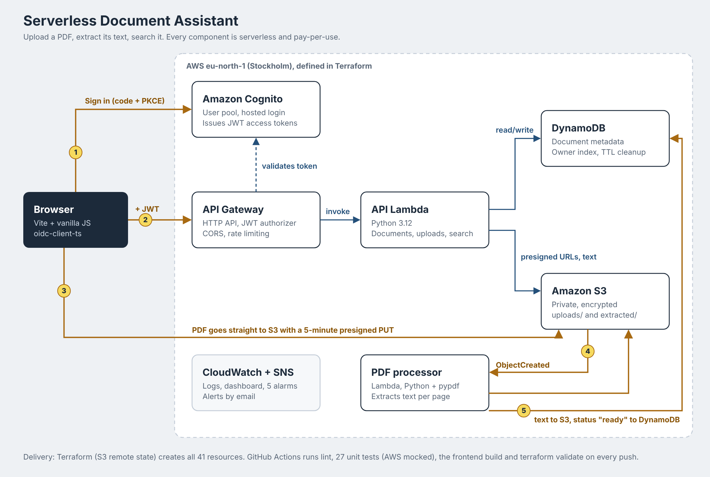

# Serverless Document Assistant on AWS

Upload a PDF, have its text extracted automatically, and search it by asking a question. Answers point to the page they come from. Every user only ever sees their own documents.

Built on AWS serverless services, deployed entirely with Terraform, and checked by GitHub Actions on every push.



## Screenshots

| Search a document | Extracted text with find |
|---|---|
|  |  |

## Features

- Sign in with Amazon Cognito (OAuth 2.0 Authorization Code + PKCE)
- Upload PDFs up to 10 MB directly from the browser to S3
- Automatic text extraction, page by page, triggered by the upload
- Search a document: the most relevant passages come back ranked, with page numbers and highlighted matches
- Full extracted text with in-page find
- Live status per document: queued, reading text, ready, couldn't read (with the reason)
- Per-user isolation: documents belong to the Cognito user; other users get a 404 even with the right ID
- Optional generative answers (Google Gemini or Amazon Bedrock) behind one setting; default is a free no-AI mode

## AWS services

| Service | Role |
|---|---|
| **Amazon Cognito** | User pool, hosted login, JWT access tokens |
| **API Gateway (HTTP API)** | REST endpoints, JWT authorizer, CORS, rate limiting, access logs |
| **AWS Lambda** (Python 3.12) | `api`: documents, uploads, search. `pdf-processor`: text extraction with pypdf |
| **Amazon DynamoDB** | Document metadata, owner index for "my documents", TTL for abandoned uploads |
| **Amazon S3** | Private encrypted storage: `uploads/` (PDFs) and `extracted/` (text as JSON) |
| **CloudWatch** | Structured JSON logs, dashboard, metric filter, 5 alarms |
| **Amazon SNS** | Alarm emails |
| **IAM** | One least-privilege role per Lambda |

## How an upload works

1. The browser signs in with Cognito and receives a JWT.
2. It asks the API for an upload. The API Lambda creates the document record (`pending_upload`) and returns a presigned S3 URL valid for 5 minutes.
3. The browser uploads the PDF straight to S3. The file never passes through Lambda or API Gateway.
4. S3 fires an `ObjectCreated` event that starts the PDF processor.
5. The processor extracts the text, saves it to `extracted/`, and sets the status to `ready` (or `failed` with a reason).

The browser also confirms the upload, and the API checks the real file size and type in S3. The two can finish in either order; a conditional DynamoDB update makes sure a late confirmation never overwrites `ready`.

## API

All routes require `Authorization: Bearer <access token>`. Base URL: Terraform output `api_url`.

| Method | Query / body | Result |
|---|---|---|
| `GET` | | List your documents |
| `GET` | `?document_id=…` | One document |
| `GET` | `?document_id=…&action=text` | Extracted text |
| `GET` | `?document_id=…&action=download` | 5-minute link to open the PDF |
| `POST` | `{title, category, file_name, content_type, file_size}` | Create a document and get a presigned upload URL (201) |
| `POST` | `?document_id=…&action=confirm_upload` | Verify the file in S3 |
| `POST` | `?document_id=…&action=ask` + `{question}` | Ranked passages (or an AI answer when enabled) |
| `DELETE` | `?document_id=…` | Delete the document, its PDF and its text |

Errors return JSON `{"error": "...", "code": "..."}` with 400, 401, 404, 405, 409, 422, 429 or 5xx.

## Security

- **Authentication**: Cognito JWTs validated by API Gateway against the user pool issuer and the app client ID.
- **Authorization**: the owner comes from the token's `sub` claim, never from the request. Unknown and foreign documents both return 404, so IDs can't be probed.
- **Least privilege**: each Lambda can only touch its own log group, the one table and specific S3 prefixes (`uploads/*`, `extracted/*`).
- **S3**: all public access blocked, SSE-S3 encryption, HTTPS-only bucket policy, short-lived presigned URLs.
- **Validation**: titles, sizes, content types and file names are checked, and the real uploaded file is checked again in S3.
- **Abuse limits**: API throttling (10 req/s, burst 20), 10 MB file limit, 300-page limit.
- **Accounts**: self sign-up disabled by default; users are created by an admin.
- **Secrets**: no keys in code or in the frontend. An optional Gemini key lives in SSM Parameter Store (SecureString).
- **Logs**: structured, never contain tokens or document text; kept 30 days.

## Run it yourself

Full guide: [docs/infrastructure.md](docs/infrastructure.md). In short:

```bash
python scripts/build.py
cd infrastructure
terraform init -backend-config=backend.hcl
terraform apply
# create a user with the command from the create_user_command output
cd ../frontend && npm install && npm run dev
```

`terraform destroy` removes everything again.

## Testing and CI

```bash
pip install -r requirements-dev.txt
pytest          # 27 tests, AWS mocked with moto
ruff check .
```

The tests cover ownership checks, validation, the upload flow in both completion orders, text extraction for normal, scanned and broken PDFs, search ranking and cleanup on delete.

[GitHub Actions](.github/workflows/ci.yml) runs on every push and pull request: lint, unit tests, Lambda packaging, the frontend production build, `terraform fmt -check` and `terraform validate`.

## Monitoring

A CloudWatch dashboard shows requests, 4xx/5xx errors, latency, Lambda errors and duration, the latest warnings and processed PDFs. Alarms email on API 5xx errors, Lambda crashes or throttles, and extraction errors. See [docs/troubleshooting.md](docs/troubleshooting.md) for how to go from a symptom to its cause.

## Cost

Nothing runs by the hour. Lambda, API Gateway, DynamoDB on-demand, S3, Cognito and SNS charge per use, so an idle demo costs close to nothing. The no-AI search mode is free; the dashboard and 5 alarms are within CloudWatch's free allowance.

## Challenges

- **POST returned 404 while GET worked.** The route existed in the console but wasn't deployed to the stage. Lesson: a 404 from API Gateway carries no CORS headers, so the browser reports it as a CORS error.
- **"Failed to fetch" on delete.** `DELETE` was missing from the CORS allowed methods, so the browser blocked the preflight.
- **A 500 hidden behind a generic message.** The Lambda role lacked `dynamodb:UpdateItem`. Returning the AWS error code to the client and logging it as JSON made this a one-minute fix.
- **A race condition.** S3 starts the processor the moment the file lands, so it could finish before the browser's confirm call, which then reset `ready` to `uploaded`. Fixed with a DynamoDB condition expression.
- **Bedrock blocked at account level.** New accounts can get "Operation not allowed" on all models. The AI layer was made provider-independent (Bedrock, Gemini or none) so the app works regardless.
- **From console to code.** The console-built version was recreated as a separate Terraform environment rather than imported, so the code had to prove it can rebuild everything from zero.

## What I learned

- How Cognito, JWT authorizers and CORS fit together, and how to read browser errors that hide the real cause
- Designing least-privilege IAM per function and S3 prefix
- Event-driven processing with S3 notifications and idempotent, conditional state updates
- Writing infrastructure as code with remote state, and testing AWS code locally with moto
- Building observability in from the start: structured logs, metric filters, alarms

## Possible next steps

- Deploy from GitHub Actions through OIDC federation (no stored AWS keys)
- Host the frontend on S3 + CloudFront with a custom domain
- Semantic search with embeddings, and OCR for scanned PDFs (Amazon Textract)

## Project structure

```
frontend/                 Vite app (vanilla JS), reads AWS settings from .env.local
backend/api/              API Lambda
backend/pdf_processor/    Text extraction Lambda
backend/tests/            pytest suite (moto)
infrastructure/           Terraform for all AWS resources, dashboard template
scripts/build.py          Packages the Lambdas
docs/                     Architecture, setup guide, troubleshooting
.github/workflows/ci.yml  CI pipeline
```
